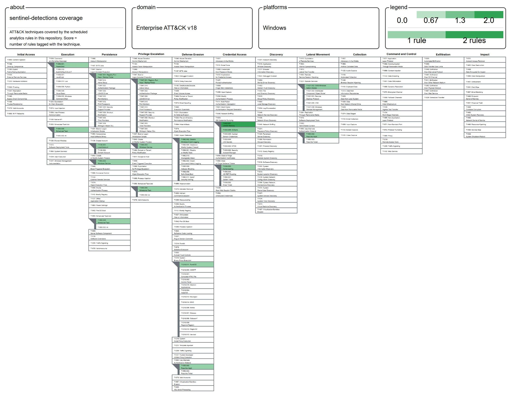
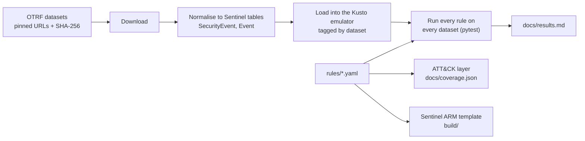

# sentinel-detections

[](https://github.com/anchit15/sentinel-detections/actions/workflows/ci.yml)
[](pyproject.toml)
[](LICENSE)

Twelve Microsoft Sentinel analytics rules in KQL, mapped to MITRE ATT&CK and tested in CI against real attack recordings and the unrelated activity around them.



*ATT&CK v18 coverage. Darker cells are covered by more than one rule.*

<!-- docs/demo.gif: demo recording goes here -->

## Why

Noisy detections do more damage in a SOC than most people expect. They bury the real alerts and teach analysts to skim. So I treated these Microsoft Sentinel rules like code: each of the 12 KQL rules is mapped to MITRE ATT&CK, has to fire on a real attack recording, has to stay quiet on everything else, and CI checks all of that on every change.

## Results

On the five rules this data can measure, tuning cut false positives from 197 to 0. Every rule fires on its attack dataset.

| Rule | Technique | Attack dataset | Attack hits | Cross-hits | FP baseline | FP tuned |
| --- | --- | --- | ---: | ---: | ---: | ---: |
| [DCSync replication request by a non-computer account](rules/credential_access/dcsync.yaml) | T1003.006 | `empire_dcsync` | 1 | 0 | 0 | 0 |
| [Kerberoasting with RC4 service tickets](rules/credential_access/kerberoasting.yaml) | T1558.003 | `purplesharp_ad_playbook_i` | 1 | 0 | 7 | 0 |
| [LSASS memory read access](rules/credential_access/lsass_memory_access.yaml) | T1003.001 | `empire_mimikatz_logonpasswords` | 1 | 4 | 153 | 0 |
| [Audit policy auditing removed](rules/defense_evasion/audit_policy_disabled.yaml) | T1562.002 | `auditpol_policy_modification` | 1 | 0 | 0 | 0 |
| [LSASS dump via comsvcs.dll MiniDump](rules/defense_evasion/rundll32_comsvcs_minidump.yaml) | T1218.011, T1003.001 | `psh_lsass_dump_comsvcs` | 1 | 0 | 0 | 0 |
| [PowerShell encoded command on the command line](rules/execution/encoded_powershell.yaml) | T1059.001 | `empire_launcher_vbs` | 1 | 0 | 3 | 0 |
| [File written to a remote administrative share](rules/lateral_movement/admin_share_write.yaml) | T1021.002 | `covenant_copy_smb` | 1 | 0 | 29 | 0 |
| [Overpass-the-hash logon with LSASS memory write](rules/lateral_movement/overpass_the_hash.yaml) | T1550.002 | `empire_over_pth` | 1 | 0 | 0 | 0 |
| [Local account created on a host](rules/persistence/local_account_created.yaml) | T1136.001 | `empire_wmic_add_user` | 1 | 0 | 0 | 0 |
| [Registry Run key value set](rules/persistence/run_key_persistence.yaml) | T1547.001 | `empire_run_keys_elevated` | 1 | 0 | 0 | 0 |
| [Scheduled task created or modified by a user account](rules/persistence/scheduled_task_by_user.yaml) | T1053.005 | `schtask_create` | 1 | 0 | 5 | 0 |
| [Service installed by a user account](rules/persistence/service_installed_by_user.yaml) | T1543.003 | `covenant_sharpsc_create` | 1 | 0 | 0 | 0 |

Each rule runs once per dataset: attack hits are rows on its own attack recording, cross-hits are rows on other recordings that contain the same ATT&CK technique (expected, so not counted as false positives), and false positives are rows on every other recording, for an untuned baseline query and for the tuned rule. The table is generated by `scripts/report.py`; see [docs/results.md](docs/results.md).

## How it works



Design decisions:

- **Rules match Sentinel's schema exactly.** Each rule file is validated against Sentinel's scheduled-rule fields with no extras allowed, and test expectations live in a separate file under `tests/cases/`. The YAML follows Sentinel's own content format, and `scripts/export_arm.py` turns it into the ARM template Sentinel's import accepts.
- **Detect the capability, not the name.** Rule 1 alerts only when a process opens LSASS with the `PROCESS_VM_READ` access bit (0x10), which reading credentials requires. That removes all 153 baseline false positives (svchost and VBoxService, whose access masks don't include the bit) without excluding any process name, so renaming a tool doesn't get it past the rule.
- **Rules can't see which dataset they're running on.** Every test shadows the tables with a filtered copy that drops the `Dataset` column, so a rule that tries to use it fails to compile instead of quietly passing.
- **Cross-hits are not false positives.** Datasets are tagged with every technique they actually contain. Rule 1 also fires on the overpass-the-hash and comsvcs recordings because both really read LSASS memory; those hits are reported as cross-hits rather than hidden or counted against the rule.
- **ATT&CK v18, on purpose.** Sentinel is aligned to ATT&CK v18. ATT&CK v20 revokes T1562.002 and splits Defense Evasion, so the rule tags and the Navigator layer stay on v18 to match what Sentinel validates.
- **CI runs every rule on every pull request.** One job lints and runs unit tests; a second starts the emulator, loads all datasets and runs the rule suite, failing rather than skipping if anything is missing. Removing rule 1's access-bit filter on a test branch turned CI red, listing each benign dataset and its hit count.

## Quick start

Needs Python 3.11 and Docker. The emulator image is about 4.6 GB on disk and the container is limited to 4 GB of memory.

```bash
git clone https://github.com/anchit15/sentinel-detections.git
cd sentinel-detections
python -m venv .venv
source .venv/bin/activate          # Windows: .venv\Scripts\activate
pip install -r requirements-dev.txt

docker compose up -d               # starts the Kusto emulator; accepts its licence (ACCEPT_EULA=Y)
python scripts/download_data.py    # fetches the datasets into data/, verifying SHA-256
python -m sentinel_detections.loader

pytest                             # unit tests and every rule against every dataset
pytest -k lsass_memory_access      # one rule's tests
python scripts/report.py           # writes docs/results.md
python scripts/build_layer.py      # writes docs/coverage.json (ATT&CK Navigator layer)
python scripts/export_arm.py       # writes build/sentinel_rules.json (Sentinel ARM template)
```

If port 8080 is already in use, copy `.env.example` to `.env` and set both `KUSTO_PORT=8081` and `KUSTO_CLUSTER_URL=http://localhost:8081`. Docker Compose and the Python code both read `.env`.

To explore the data, `python scripts/kql.py query.kql` runs any KQL file against the emulator and prints the rows.

## Project structure

```text
.github/workflows/      CI: lint and unit tests, and rule tests against the emulator
data/                   manifest.yaml with pinned dataset URLs and hashes; downloads are git-ignored
docs/                   results table, ATT&CK Navigator layer and coverage image
rules/                  the 12 Sentinel scheduled rules, one YAML file each, grouped by tactic
scripts/                download, results report, layer build, ARM export and a KQL query tool
src/sentinel_detections/  normaliser, loader, rule validation, test harness and exporters
tests/                  unit and rule tests; tests/cases/ holds one test case per rule
docker-compose.yml      the pinned Kusto emulator image
```

## Limitations

The data is from a lab. Every attack comes from OTRF Security-Datasets, which are short recordings from a small test domain. Production is much noisier, so zero false positives here doesn't mean zero in a real SOC.

I could only measure tuning on 5 of the 12 rules. There's no clean benign dataset to test against, so false positives are counted on the background activity inside the other attack recordings. For the other seven rules, the events they look for only exist in their own dataset, so their tuning is based on the false positives I'd expect in production. Each rule's description says what those are.

Most rules are proven against one recording, often a single event. That shows the logic catches the technique as it happened here, not every variant of it.

The tests run on Microsoft's Kusto emulator, not Sentinel. The tables follow Sentinel's schemas, but ASIM parsers, watchlists, scheduling and incident grouping aren't tested, and a few columns are my best approximation of what the Sentinel agent produces.

The ARM template follows the structure of Sentinel's own exports, but I haven't imported it into a live workspace yet.

Two data quirks: one dataset logged time on a 12-hour clock with no AM/PM, so the loader corrects it using Sysmon's UTC timestamps and fails if the offset isn't constant. The Sysmon version in the data doesn't record which user acted. The rules built only on Sysmon don't map an Account.

Every rule has trade-offs, and each is written up in the rule itself. A few worth knowing: DCSync ignores computer accounts, so an attacker using a stolen domain controller account would slip through. Kerberoasting only looks at RC4 tickets. The encoded PowerShell and comsvcs rules don't filter on process name, which catches renamed binaries but could match other tools. The Run key rule alerts on every write.

Scope: Windows host logs only, mapped to ATT&CK v18 because that's the version Sentinel uses.

## Future work

- A proper benign dataset so every rule's tuning can be measured
- Importing the ARM template into a real Sentinel workspace
- Rules for Entra ID sign-ins, Defender XDR and Linux
- Moving to ATT&CK v20 once Sentinel does

## Licence and credits

The code and rules are MIT licensed; see [LICENSE](LICENSE).

- Attack data: [OTRF Security-Datasets](https://github.com/OTRF/Security-Datasets) (MIT). The datasets are downloaded at run time and not stored in this repository.
- Query engine: the [Kusto emulator](https://learn.microsoft.com/azure/data-explorer/kusto-emulator-overview) (`kustainer-linux`), under the Microsoft Software License Terms. The image is pulled from Microsoft's registry and never redistributed.
- [MITRE ATT&CK](https://attack.mitre.org/). MITRE ATT&CK and ATT&CK are registered trademarks of The MITRE Corporation.
